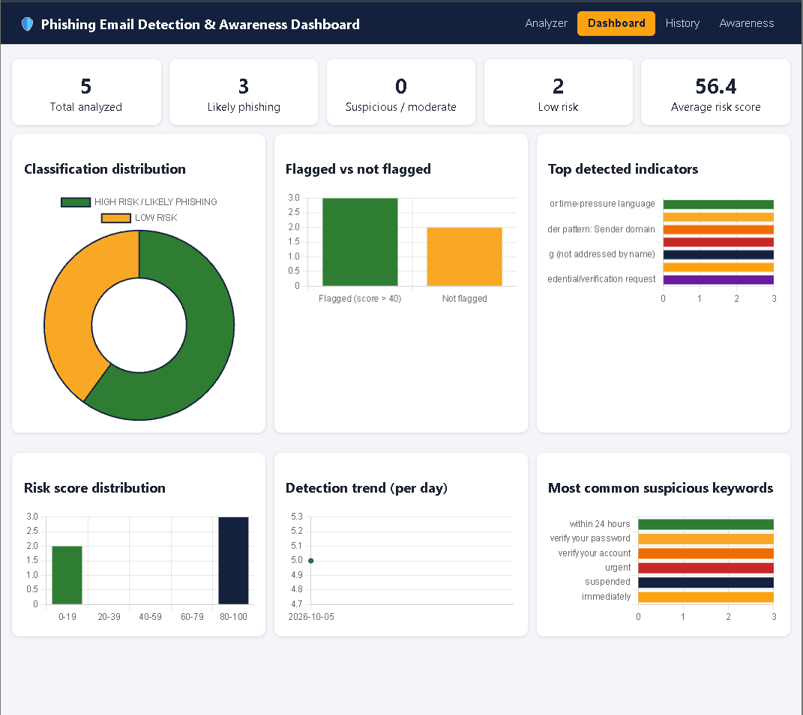
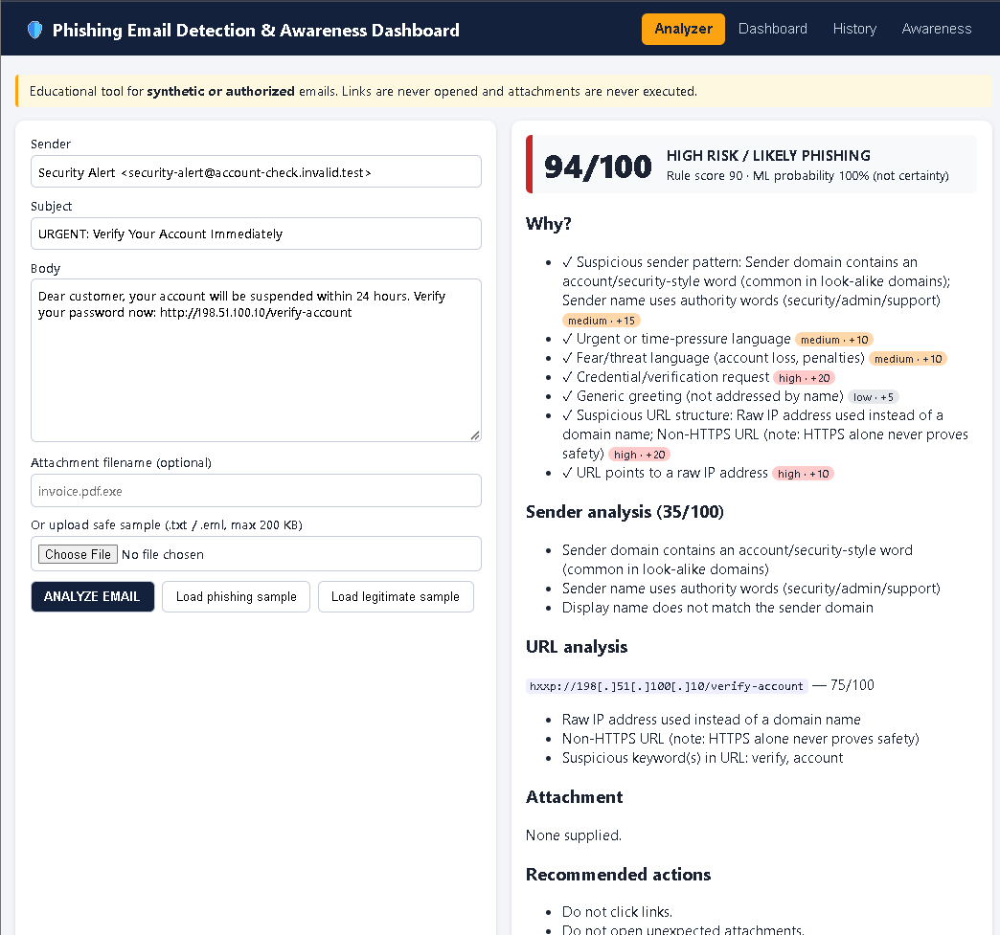
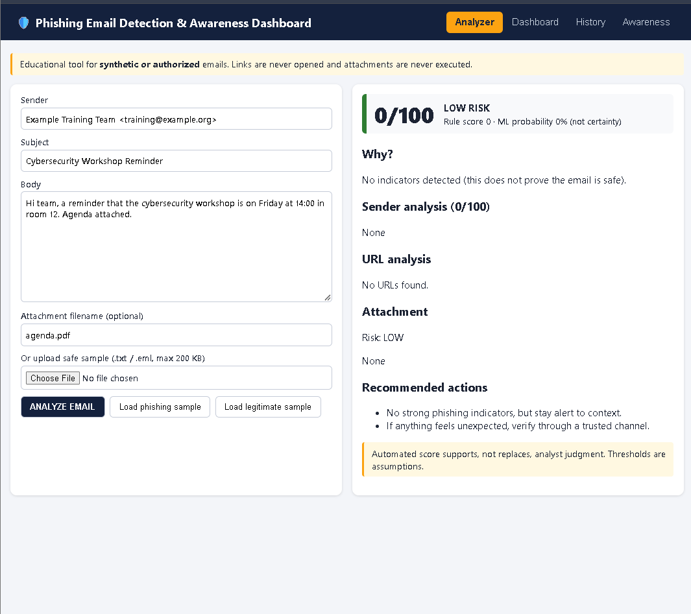
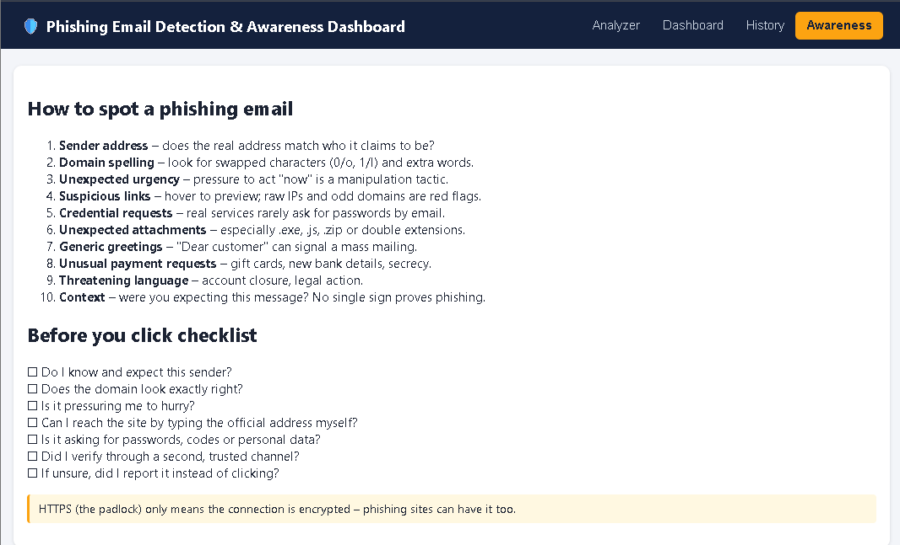

# Phishing Email Detection & Awareness Dashboard

> This project is designed for cybersecurity education and defensive analysis using synthetic or authorized data.

## Overview
A defensive dashboard that analyzes an email's sender, subject, body, URLs and attachment filename, produces an **explainable risk score (0-100)**, classifies it, recommends actions, stores metadata-only history and shows analytics. Nothing is ever fetched, opened or executed.

## Problem Statement
Phishing is a leading initial-access technique. Analysts and users need fast, transparent triage, not a black-box "phishing / not phishing".

## Features
Sender analyzer · content (social-engineering) analyzer · static URL analyzer · attachment filename analyzer · rule-based risk engine · optional ML (TF-IDF + structured features) · hybrid score · SQLite history · REST API · dashboard with 6 charts · awareness module · 29 automated tests.

## Architecture
`Browser dashboard -> Flask API -> preprocess -> [sender | content | URL | attachment | optional ML] -> risk engine -> classification + explanations + recommendations -> SQLite + dashboard`

## Quick start
```bash
python -m venv venv && source venv/bin/activate      # Windows: venv\Scripts\activate
pip install -r requirements.txt
python data/generate_dataset.py                      # 600 synthetic emails
python -m ml.train_model                             # optional ML (writes reports/ + models/)
pytest -v                                            # tests
python -m backend.app                                # open http://127.0.0.1:5000
```
Use the **Load phishing sample / Load legitimate sample** buttons, click ANALYZE, then open Dashboard and History.

## Risk scoring (project assumptions - calibrate with validation data)
Sender +15, urgency +10, fear +10, credential +20, financial +10, reward +10, personal-info +10, call-to-action +5, generic greeting +5, formatting +5, suspicious URL +20 (+10 raw IP), attachment +25; capped at 100.
Bands: 0-20 LOW RISK · 21-40 MODERATE · 41-70 SUSPICIOUS · 71-100 HIGH RISK / LIKELY PHISHING. There is intentionally no "SAFE": static analysis cannot prove safety.
With a trained model: `final = 0.6*rule + 0.4*ML probability*100` (a probability is not certainty).

## API
| Method | Endpoint | Notes |
|---|---|---|
| POST | /api/analyze | JSON `sender, subject, body, attachment_name`; 201, 400 validation, 429 rate limit |
| POST | /api/analyze/url | JSON `url`; static analysis only |
| GET | /api/analyses | `q, classification, sort(created_at\|risk_score), order` |
| GET / DELETE | /api/analyses/{id} | 200/204, 404 |
| GET | /api/dashboard/stats, /api/dashboard/indicators | analytics |

Auth endpoints (register/login/logout) are listed as future work; a `users` table is already in the schema.

## Security & privacy
Body never stored (only domain, subject, score, indicators) · all rendered text escaped, no raw HTML · strict CSP · 1 MB request limit, field-length validation · per-IP rate limit · URLs defanged in output · attachments never opened · secrets via `.env`.

## Results (from my own runs)
See `reports/ml_metrics.json` and `reports/confusion_matrix.png`. **Honest caveat:** the synthetic data is template-generated, so models score near-perfectly on it; that does not predict real-world performance.

## False positives & negatives
A legitimate HR email saying "Urgent: submit documents today" scores low-but-nonzero (urgency). A polite, well-written phishing email with an HTTPS link scores 0 on rules; only the ML component flagged it in my test. Use multiple signals and analyst review.

## Limitations
Regex keyword rules, English only, no header/SPF/DKIM/DMARC analysis, no reputation feeds, synthetic training data, no authentication yet.

## Future improvements
Header analysis, SPF/DKIM/DMARC ingestion, domain/URL/hash reputation, better NLP, SIEM/ticket integration, user reporting workflow, feedback-based retraining.

## Screenshots
Store in `screenshots/` (see docs/GUIDE.md for the checklist).

 
<br><br>

<br><br>

<br><br>


## Author
Piyush K. Ahirwar - Cybersecurity student
